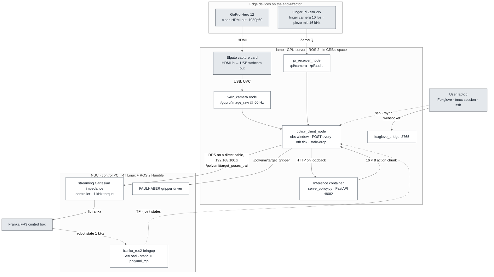
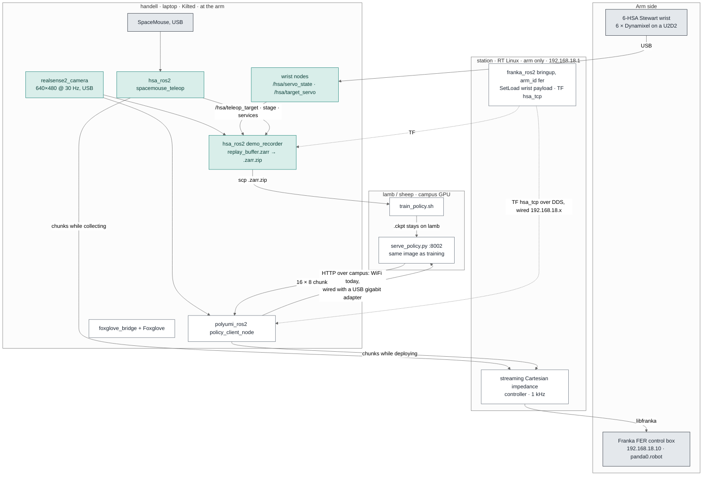
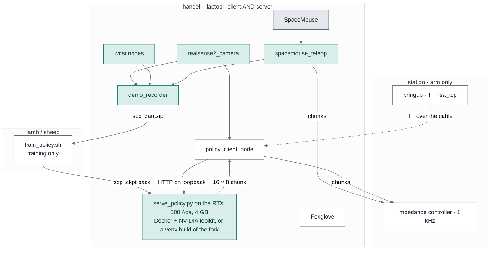
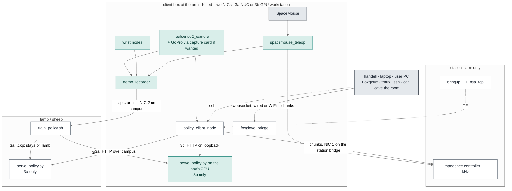
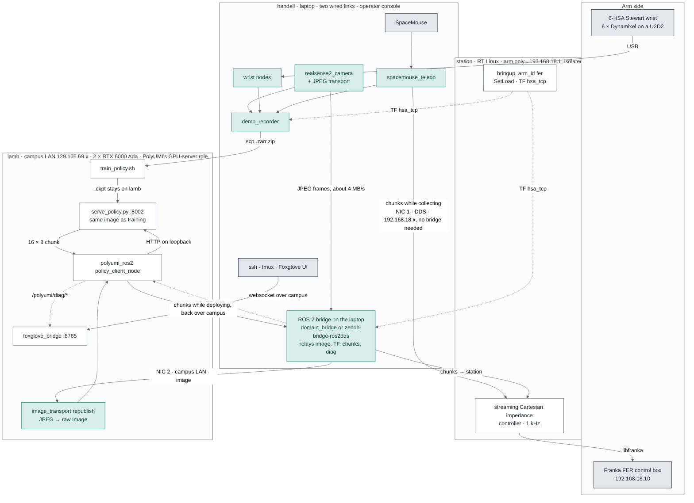
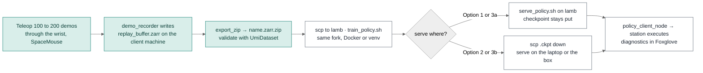

# HSA-UMI Architecture Options

Status 2026-09-30: a decision document; Option 2 has been brought up and measured on the laptop (Section 4), and Option 4, the client on lamb, is analysed in Section 6. Three ways to lay HSA-UMI out across machines, each measured against how PolyUMI is physically built. Mermaid sources below render on GitHub and in the published page; copy them anywhere mermaid renders.

## 1. How PolyUMI is physically set up

Your reading was close. Three corrections, from their architecture figure and the `docs/crb-fr3-inference.md` and `config/env.lamb.sh` files in the repo:

- **The capture card is HDMI in, USB out.** The GoPro's clean HDMI output goes into an Elgato card, which shows up on lamb as an ordinary USB webcam (`/dev/video2`). A `v4l2_camera` node reads it and publishes the frames as a ROS topic at 60 Hz. Nothing HDMI reaches lamb; the card exists only because a GoPro has no USB video mode. A RealSense needs no card.
- **lamb runs three things, not two.** The "data client nodes" (the capture-card reader, the finger-camera and mic receiver over ZeroMQ, the Foxglove bridge), the inference client node (`policy_client_node`, which assembles the observation window, POSTs it, drops stale actions and publishes chunks), and the inference container (`serve_policy.py`, FastAPI on port 8002). Client and server sit on the same machine, so the request never leaves loopback.
- **The laptop is the operator console.** Foxglove over a websocket, `fr3_session.sh` opening tmux panes on lamb and the NUC and rsyncing the working copy to them, ssh. Before lamb took over, the same laptop ran the client and the capture card itself; the files for that phase are still in the repo (`setup_franka_env.sh`, `ros2_ws/config/cyclonedds_laptop.xml`).

The NUC is the control PC and nothing else: real-time Linux, `franka_ros2`, the streaming Cartesian impedance controller, the gripper driver, the home service.



## 2. What is different on your side

| | PolyUMI at CRB | HSA-UMI |
|---|---|---|
| Arm and control PC | FR3 driven by a NUC | FER driven by the NU-MSR station: same role, already built, already isolated on its own subnet |
| GPU server | lamb, in the same room, cabled to the NUC | the same lamb (and sheep), in CRB's space, reachable only over the campus network |
| Wrist camera | GoPro over HDMI and a capture card | RealSense over USB, no card needed |
| End-effector | PolyUMI fingers, FAULHABER driver | 6-HSA soft Stewart wrist on a Dynamixel bus, no gripper yet |
| Demo source | handheld gripper, SLAM, `pingest` | SpaceMouse teleop through the wrist, recorder writes the dataset live |
| Operator PC | laptop, Foxglove and tmux | this laptop, plus whatever else the option below gives it |

The one fact that decides everything: lamb is almost certainly the same machine PolyUMI cables into. Both projects name `lamb.mech.northwestern.edu`, and PolyUMI's `config/env.lamb.sh` gives it a direct link to CRB's NUC on `192.168.100.x`. That cable ends at their arm, not yours. So whatever lamb does for you, it does over the campus network, and the machine that holds your camera has to be at your arm. Confirm with:

```bash
ssh yui0833@lamb.mech.northwestern.edu 'hostname; lsb_release -ds; ls /opt/ros; nvidia-smi -L; ip -br addr | grep 192.168.100; ls -d ~/PolyUMI ~/Documents/PolyUMI 2>/dev/null'
```

A `192.168.100.1` address or a PolyUMI checkout settles it.

## 3. Option 1: laptop as the client, lamb as the server

PolyUMI's own earlier configuration, before they moved the client onto lamb. The laptop takes the role lamb's ROS half plays: cameras, SpaceMouse, wrist bus, teleop, recorder, policy client, Foxglove bridge. The station stays arm-only. lamb trains and serves; the observation crosses the campus network every eighth tick and the checkpoint never moves.



- **Runs where.** Station: bringup and controller, PolyUMI's `nuc/` code with the FER renames. Laptop: everything in `polyumi_ros2` and `hsa_ros2`, already built and desk-tested here under Kilted. lamb: training and the server, exactly as PolyUMI.
- **Network.** Built-in port to the station on its DHCP lease (the station's clock, name service and default route all hang off that lease). Campus over WiFi today; a USB gigabit adapter into a lab jack makes it wired, which is what PolyUMI's laptop had (theirs was a 100 Mbit part, and their notes measure the cost: 24 ms per request instead of 2.4).
- **Latency.** Capture to stamp on a RealSense, a few tens of ms; tick phasing up to 100; link 2 ms wired, 3 to 60 on WiFi; forward pass on lamb 100 to 400 depending on who else is on it; arm lag 40 to 90. Comfortably inside the 800 ms chunk budget wired, with less margin on WiFi.
- **To buy.** Nothing. A USB gigabit adapter if you want the campus hop wired.
- **Cost.** The rollout depends on lamb's load and on the campus network. Both show up on the client's diagnostic topics rather than as silent misbehaviour, but they are outside your control.

## 4. Option 2: laptop as client and server

PolyUMI's final configuration, where one machine runs both halves and the request is on loopback, reproduced on the laptop. Training stays on lamb; the checkpoint is copied down, which is the workflow you described. This is the option the last question in your message was really asking about, and it is viable.



- **Does it fit?** The policy is a CLIP ViT-B/16 encoder plus a UNet with widths 256, 512 and 1024: about 150M parameters, roughly 0.6 GB of weights and under 2 GB of GPU memory at batch one. The laptop's 4 GB is enough for inference and nowhere near enough for training, which is fine because training was never going to be here.
- **How fast? Measured.** The image builds on the laptop and the full loop ran on it (29 September 2026): the container's forward pass is 209 ms mean, 217 ms p95 at 16 DDIM steps; loopback overhead 12 ms; whole request 222 ms; 11 of every 16 waypoints still fresh on arrival. A busy lamb is 100 to 400 ms. `num_inference_steps` can drop from 16 to 8 (120 ms in the venv benchmark) at a small cost in action quality. Procedure and scripts: `hsa_ros2/README.md`, section 8.
- **Same environment as training.** A checkpoint is pickled against the exact dependency tree it was trained in. Building the fork's Docker image on the laptop gives you that tree byte for byte, with no conda on the host, at the price of installing the NVIDIA container toolkit (Docker is already here, the toolkit is not). A venv build of the fork with a pinned freeze from lamb is the conda-free alternative.
- **To buy.** Nothing. The NVIDIA container toolkit is installed and the image is built.
- **Cost.** One laptop does capture, teleop or inference, recording and Foxglove. The 22 cores and 30 GB of RAM are ample; the GPU and its thermals are the unknown. Switching between this option and Option 1 is one parameter, the server URL, so both can coexist.

## 5. Option 3: a dedicated client box at the arm

PolyUMI's three-box layout reproduced exactly: a machine next to the station that plays lamb's role, and the laptop back to being the operator console. Two sub-options depending on what the box has in it.



- **3a, a NUC.** Holds the cameras, the SpaceMouse, the wrist bus and all the ROS nodes; the server stays on lamb. The laptop is free and the rig is permanent, but the inference request still crosses campus, so this buys convenience, not latency. Note a NUC is not needed for the control-PC role PolyUMI uses one for: your station already is that.
- **3b, a small workstation with a discrete GPU.** Everything 3a has plus the server on its own GPU: loopback inference, no dependence on lamb's load, and small training runs possible locally. A 12 to 16 GB card is plenty. This is PolyUMI's layout with nothing renamed.
- **Both.** Two network interfaces: one into the station's bridge, one into a campus jack. The box becomes the station's time source and internet route, which the NU-MSR design currently expects the laptop to be; that is a better fit for a machine that never leaves. Provisioning is a day: Ubuntu 24.04, Kilted, `rosdep`, the two packages, the RealSense driver, `pyspacemouse`, chrony.
- **Capture card.** Only if you put a GoPro on the wrist for the fall plan's second camera. It converts HDMI to a USB webcam; a RealSense or any USB camera does not need it.
- **To buy.** 3a: a NUC and a USB or Thunderbolt NIC. 3b: a GPU workstation and a second NIC. Optionally an Elgato card.

## 6. Option 4: client on lamb, the arm behind a bridge

Your proposal: RealSense and SpaceMouse on the laptop, the laptop wired both to the station and to
the campus LAN, and lamb running PolyUMI's whole GPU-server role, the data client nodes, the
inference client and the inference container on loopback, with the laptop as the operator console.
That is PolyUMI's three boxes literally. Two things differ from CRB and decide whether it is worth
doing.

First, the camera is not on lamb. PolyUMI's GoPro plugs into lamb through a capture card; yours is
USB on the laptop, so the frames have to travel to lamb as a ROS topic. Raw `rgb8` at 640x480 and
30 Hz is 28 MB/s, so they go as JPEG (about 4 MB/s, fine on a wired gigabit link, not on WiFi) and a
small `image_transport` republisher on lamb turns them back into the raw `Image` the client
subscribes to. Cost: a few milliseconds of encode and decode per frame and a second node.

Second, lamb cannot see the arm. The station lives on `192.168.18.0/24` behind the laptop and has no
route to campus, and lamb has no route to it; DDS discovery does not cross that gap on its own. The
laptop, which sits on both links, has to relay the ROS traffic: the image and TF outward to lamb, the
action chunks and gripper commands back to the station. Two standard ways to do that, neither needing
root anywhere: `domain_bridge` on the laptop alone, relaying a named list of topics between the
station-side domain and the lamb-side domain (apt package on Kilted), or `zenoh-bridge-ros2dds` on
both machines, which also carries services and actions and tolerates campus routing and firewalls by
using one TCP port. The lamb side runs from a user-space binary, since you have no sudo there.



- **What it needs beyond Option 1.** A USB gigabit adapter for the second link; the bridge on the laptop (and on lamb for zenoh); `image_transport` plugins on the laptop and the republisher on lamb; your own HSA-UMI checkout on lamb with `polyumi_ros2` built, which `deploy_lamb.sh` already does for PolyUMI; and a test that DDS or the bridge's port passes between the lab jack and lamb's subnet, which is the one unknown, since campus VLANs sometimes filter UDP. Clocks are already consistent: the laptop and lamb follow campus NTP, the station follows the laptop.
- **Collection is unchanged.** Teleop and the recorder stay on the laptop and talk to the station over the cable, so demos never depend on lamb or the campus network. Only deployment goes through the bridge.
- **Latency.** The HTTP hop of Option 1 disappears (loopback, as at CRB), but three new hops appear: JPEG encode and decode, the image and TF relay outward, and the chunk relay back. Wired, the sum is in the same band as Option 1's 2 ms hop plus a few milliseconds; on WiFi it is not usable, because the image stream is continuous rather than one request per 0.8 s.
- **Robustness, the real difference.** In Option 1 the arm's command path is local: the client sits at the arm, and a campus hiccup delays one inference while the arm finishes the previous chunk. Here the command path itself crosses campus twice, image out and chunks back, and TF has to arrive on lamb before the client can build an observation. A campus stall stops the arm rather than an inference. That is the reason PolyUMI's lamb holds the client: it is cabled to their NUC in the same room. Moved across campus, the same layout inverts its own justification.

Verdict: feasible, and a clean copy of PolyUMI's structure, but for your building it trades the one thing that layout was protecting. Option 1 runs the identical client code on the machine that is at the arm and reaches lamb by a single HTTP request; Option 3b is this layout done properly, with the GPU box next to the station. Try Option 4 only if a measurement on the real link shows the bridged path is not worse, which the client's own diagnostics will tell you.

## 7. Not recommended: everything on the station

The first plan put cameras, teleop, recorder and the policy client on the station. It gives one clock and one machine, but it loads the real-time box with capture and inference, forces a port of the client packages from Kilted to Humble, and is the layout PolyUMI deliberately avoids. Dropped.

## 8. Recommendation and the ladder

1. **Start with Option 1 today.** Nothing to buy, everything already runs on the laptop. Bring the station side up (Section 3 of the collection plan), then point the client at the dummy server on lamb and read the overhead diagnostic; then the real server.
2. **Set up Option 2 in parallel.** Install the NVIDIA container toolkit, build the fork's image here, time the forward pass. Keep both server URLs in the config; pick per session. Option 2 wins whenever lamb is busy or you are on WiFi; Option 1 wins on raw model time if lamb is idle.
3. **Budget Option 3b for the fall rig.** Two cameras, a 16-dimensional action, 200-episode collection sessions and the DAgger loop are a lot to hang off one laptop, and a box that stays at the arm makes the whole setup reproducible for whoever comes after you. It is the layout PolyUMI arrived at; you would just be arriving at it with a smaller GPU next to the arm and the big one across campus.

Under all three the station runs the same code, the dataset has the same layout, and the policy client publishes the same messages as the teleop node. Moving between options is configuration, not code.

## 9. The policy workflow, translated

PolyUMI's six steps become five: there is no preprocessing stage because the recorder writes the training format directly.



## 10. What this changes in the earlier diagram page

Figures 1 and 2, the PolyUMI pair, match their published architecture; two small additions would complete figure 1: the user laptop with Foxglove, and the finger camera and mic reaching lamb over ZeroMQ, which is only a footnote there. Figures 3 and 4 show the station-only layout of Section 6 and are superseded; they get redrawn in whichever option you pick, with the collection plan and the `hsa_ros2` README updated in the same pass.
