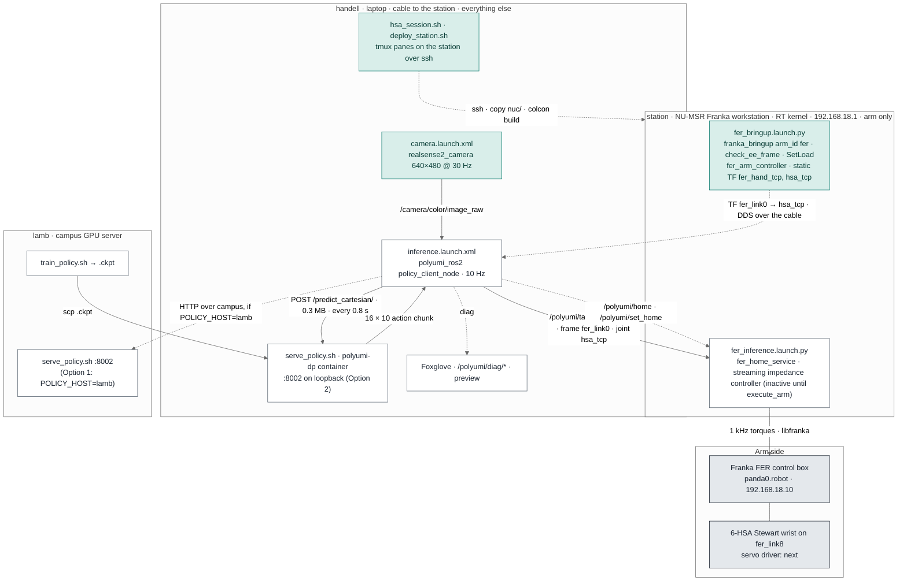
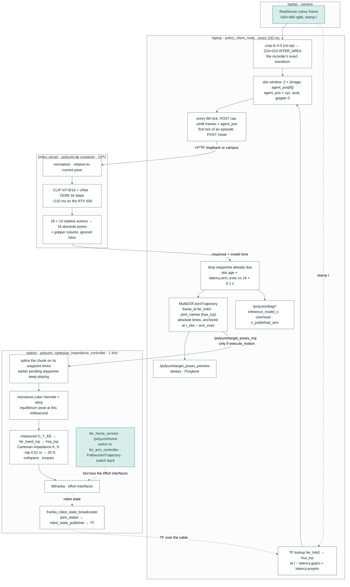

# HSA-UMI: the FER arm and the policy, station to laptop

The HSA-UMI counterpart of [crb-fr3-inference.md](crb-fr3-inference.md): how PolyUMI's arm
control and inference layer is laid out on the Murphey Lab's Franka FER with the 6-HSA soft
Stewart wrist, and how to bring it up. Same controller, same client, same server, same wire
contract; what changes is the arm (FER, `arm_id:=fer`), the end effector (a wrist bolted to the
flange, no hand), the control PC (NU-MSR's Franka station instead of CRB's NUC) and where the GPU
work runs (this laptop by default, lamb as the alternative).

Status 2026-09-30: written and tested without the robot, in the deployment topology: the mock FER
bringup, both static frames, the loaded streaming controller and `/polyumi/home` on the station,
with the RealSense, the policy container and `policy_client_node` on the laptop, FastDDS across
the cable, the station on its Kilted Franka workspace, and the station's clock following the
laptop to within microseconds. Over 40 s the
client reported 195 ms median and 228 ms p95 per inference (186 ms model), 289 ms observation
age, 12 of 16 waypoints published per chunk, and a home request from the laptop moved the mock
arm on the station. On the arm, 2026-10-01 (bare flange, `HSA_TOOL=bare`): the first real bringup passed end to end,
libfranka connected, the frame check matched Desk, the payload push accepted, `fer_arm_controller`
activated inside the realtime loop, then the streaming Cartesian impedance controller took the arm
(`activated holding hsa_tcp at (0.621, 0.044, 0.418)`), `/polyumi/home` executed, and SpaceMouse
teleop drove it. The first teleop was slow and jittery because the station answered only half the
robot's cycles; see section 5 for the cause and the fix. The numbers marked ESTIMATE in `nuc/hsa_calib.py` and the two `latency.*` values are
placeholders to be measured on the first session; every bringup log says so until they are.

## 1. What runs where



Three boxes, as at CRB. The station is PolyUMI's NUC: real-time Linux, `franka_ros2`, the
streaming Cartesian impedance controller, and nothing else. This laptop is PolyUMI's lamb *and*
their operator laptop in one: it runs the camera, `policy_client_node`, Foxglove, the session
script, and by default the policy container too, so the inference request stays on loopback
exactly as it does on their lamb (Option 2 in
[hsa-architecture-options.md](hsa-architecture-options.md), measured at about 220 ms per
inference on this laptop's RTX 500). lamb trains, and can serve instead (`POLICY_HOST=lamb`,
Option 1) when a checkpoint is too large for 4 GB or the laptop is busy.

Nothing runs in Docker on the station. The one container in the system is the policy server,
which is the training image serving a checkpoint; it runs wherever the GPU is.

## 2. One inference tick, end to end



Everything in white is PolyUMI's code running unchanged, with three parameters set to our names:
`base_frame: fer_link0`, `eef_frame`/`tcp_frame: hsa_tcp`, `image_topic: /camera/color/image_raw`.
The two green boxes are ours: the camera, and a home service that moves through
`fer_arm_controller` directly instead of move_group.

| topic / service | producer → consumer | contract |
|---|---|---|
| `/camera/color/image_raw` | realsense2_camera → policy_client_node, demo_recorder | rgb8 640×480 at 30 Hz, 4:3 so the shared crop is a no-op |
| `/tf`, `/tf_static` | station → laptop | `fer_link0 → … → fer_link8 → hsa_tcp`; `fer_link8 → fer_hand_tcp` (franka's O_T_EE frame) |
| `POST /predict_cartesian/`, `/reset`, `/health` | policy_client_node → serve_policy.py | `polyumi_inference` wire format: raw uint8 frames + 8-D agent_pos; 16 × 10 actions back |
| `/polyumi/target_poses_traj` | policy_client_node, spacemouse_teleop → the streaming controller | `MultiDOFJointTrajectory`, `frame_id == fer_link0`, `joint_names == [hsa_tcp]`, absolute times |
| `/polyumi/target_poses_preview` | policy_client_node → Foxglove | `PoseArray` of the same chunk, published whether or not execution is on |
| `/polyumi/home`, `/polyumi/set_home` | anyone → fer_home_service | `std_srvs/Trigger`; home MOVES THE ARM |
| `/polyumi/diag/*` | policy_client_node → Foxglove, `hsa_ros2 diag_stats` | one `Float32` per scalar; `n_published_arm` is the one to watch |

## 3. Bringing up a session

```bash
# once, from the laptop: a key on the station, and an ssh alias for it
ssh-copy-id msr@192.168.18.1
printf 'Host station\n    HostName 192.168.18.1\n    User msr\n' >> ~/.ssh/config

# every session: power on the arm, unlock it, enable FCI at https://station.robot, then
./hsa_session.sh                  # server on this laptop (Option 2)
POLICY_HOST=lamb ./hsa_session.sh # server on lamb (Option 1)
```

The script copies `nuc/` and the controller submodule to the station (tar over ssh: the station
has no rsync and no internet to get one) and rebuilds the controller
there (`./deploy_station.sh`, `SKIP_DEPLOY=1` to skip), then opens four panes. Safe commands run
themselves; the three that decide whether anything moves are pre-typed for you to press Enter on.
It is doing these steps:

### 1. Station: hardware

Enable FCI first. Then, in a shell with the environment sourced (`nuc/station_env.sh` adds the
controller overlay and the DDS settings to what the station's own `.bashrc` provides):

```bash
source ~/HSA-UMI/nuc/station_env.sh
ros2 launch ~/HSA-UMI/nuc/launch/fer_bringup.launch.py
ros2 launch ~/HSA-UMI/nuc/launch/fer_bringup.launch.py desk_end_effector:=hand   # if Desk says Franka Hand
```

In order: `franka_bringup` (`arm_id:=fer`, `load_gripper:=false`), `check_ee_frame.py` (reads the
robot's own `F_T_EE` and refuses to continue if it is not the end effector the launch assumed),
`set_payload.py --calib hsa_calib` (the wrist's mass and inertia, pushed while no controller holds
the arm; a rejected payload aborts the launch), then the `fer_arm_controller` spawner. Alongside,
two static transforms: `fer_link8 → hsa_tcp` (the policy's frame) and `fer_link8 → fer_hand_tcp`
(the frame the controller reads the measured pose in). Kept separate from step 2 because this is
the piece that crashes mid-session and the one gated on FCI.

### 2. Station: inference stack

```bash
ros2 launch ~/HSA-UMI/nuc/launch/fer_inference.launch.py                    # loaded, nothing moves
ros2 launch ~/HSA-UMI/nuc/launch/fer_inference.launch.py execute_arm:=true  # servo drives the arm
```

Starts `fer_home_service` and loads `polyumi_cartesian_impedance_controller` inactive. Only
`execute_arm:=true` switches the arm from `fer_arm_controller` to the servo; from that moment the
next chunk on `/polyumi/target_poses_traj` drives torques.

### 3. Policy server

```bash
# on this laptop (rootful Docker, so run the container as yourself):
CKPT=/abs/path/to/<name>.ckpt USER_FLAG="--user $(id -u):$(id -g)" ./serve_policy.sh
# on lamb (rootless Docker, the defaults):
ssh lamb 'cd ~/repos/HSA-UMI && CKPT=/abs/path/to/<name>.ckpt ./serve_policy.sh'
curl http://localhost:8002/health
```

The image must be the one the checkpoint was trained with (`./build_policy_image.sh` from the
same commit on both machines); a checkpoint is dill-pickled against the exact dependency tree.

### 4. Laptop: client

```bash
source setup_franka_env.sh        # RMW, domain 0, CYCLONEDDS_URI for this laptop, the DHCP link
ros2 launch hsa_ros2 inference.launch.xml                          # log + preview only
ros2 launch hsa_ros2 inference.launch.xml execute_motion:=true     # chunks go to the arm
```

Default is log-only: chunks are previewed on `/polyumi/target_poses_preview` and the arm does not
move. Recommended first pass on the arm: real server, `execute_arm:=false` on the station and
`execute_motion:=false` here, watch the preview poses in Foxglove; sane output sits near the
current `hsa_tcp` with small step-to-step deltas. Then `execute_arm:=true` with the arm in a roomy
pose, then `execute_motion:=true`, e-stop in hand.

### Without a robot: the same session on mock hardware

```bash
# any machine with franka_ros2 built and sourced (this laptop: ~/ws/franka); pick a private domain
export ROS_DOMAIN_ID=79 ROS_LOCALHOST_ONLY=1
ros2 launch nuc/launch/fer_bringup.launch.py use_fake_hardware:=true robot_ip:=127.0.0.1
ros2 launch nuc/launch/fer_inference.launch.py           # home service; the impedance spawner fails here, expected
ros2 launch hsa_ros2 inference.launch.xml                # RealSense + client against the server on :8002
ros2 service call /polyumi/home std_srvs/srv/Trigger "{}"   # the mock arm moves; hsa_tcp follows in TF
```

`ros2_ws/src/hsa_ros2/scripts/station_mock_test.sh` runs the same thing in the deployment topology,
with the mock bringup on the station over ssh and everything else here, and prints the diagnostics.

`use_fake_hardware:=true` swaps libfranka for ros2_control's mock hardware: the URDF, the
broadcasters, `fer_arm_controller` (position-commanded here), both static frames and the home
service all run for real, the two bringup gates are skipped, and the streaming controller cannot
load (it needs franka's model interfaces), so nothing consumes the client's chunks. It is the
test for everything except torques: the client sees a moving `hsa_tcp`, the container answers,
`n_published_arm` reads out, and a home request drives the mock joints to the taught pose.

### A repeatable start pose

```bash
ros2 service call /polyumi/set_home std_srvs/srv/Trigger "{}"   # teach: does NOT move
ros2 service call /polyumi/home     std_srvs/srv/Trigger "{}"   # before every trial: MOVES THE ARM
```

Same services, same persisted file (`~/.ros/polyumi_home_pose.yaml` on the station) as PolyUMI.
Check what is on file before the first home of a session: the inference launch logs `Home pose from
the taught pose in ...` with the joints at startup, and `/polyumi/home` goes there and nowhere else.
Mock-hardware sessions pass their own file (`home_pose_file:=/tmp/hsa_mock_home_pose.yaml`, which the
station test does by itself) so a mock `set_home` can never overwrite the real arm's pose. Home only
once the inference launch has settled (streaming controller active): a switch landing mid-move
freezes the arm wherever it is.
The move is a straight joint-space interpolation through `fer_arm_controller` at 0.3 rad/s on the
joint with furthest to go, without a collision check: teach start poses that such a move reaches
safely, and watch the first home from any new pose.

## 4. The files

| File | Role | PolyUMI's equivalent |
|---|---|---|
| `nuc/hsa_calib.py` | The wrist: `hsa_tcp` off `fer_link8`, the Desk end-effector frame, the payload. ESTIMATE placeholders until measured. | `nuc/tcp_calib.py` |
| `nuc/check_ee_frame.py` | Bringup guard: the published `fer_hand_tcp` must equal the robot's `F_T_EE`. | none (the FR3's hand frame came from the URDF) |
| `nuc/set_payload.py` | Unchanged behaviour; grew `--calib hsa_calib`. | itself |
| `nuc/fer_home_service.py` | `/polyumi/home`, `/polyumi/set_home` through `fer_arm_controller`. | `nuc/fr3_home_service.py` (move_group) |
| `nuc/launch/fer_bringup.launch.py` | The hardware session. | `nuc/launch/fr3_bringup.launch.py` |
| `nuc/launch/fer_hardware.launch.py`, `nuc/config/controller_manager.yaml` | The station's own copy of `franka.launch.py` and the controller-manager parameters it loads (overrun management off). | `franka_bringup`'s `franka.launch.py` and `controllers.yaml`, used as shipped |
| `nuc/launch/fer_inference.launch.py` | Home service + streaming controller, `execute_arm`. | `nuc/launch/fr3_inference.launch.py` |
| `nuc/config/hsa_controllers.yaml` | The controller's parameters for the FER and `hsa_tcp`. | `nuc/config/polyumi_controllers.yaml` |
| `nuc/config/fer_arm_controller.yaml`, `fer_arm_controller.mock.yaml` | `fer_arm_controller` for the robot (effort) and for mock hardware (position), NU-MSR's values plus the controller `type`. | the `-t` flag and `franka_fr3_moveit_config`'s yaml |
| `nuc/config/cyclonedds_station.xml`, `nuc/station_env.sh` | The station's DDS config and shell environment, synced with `nuc/`. | the NUC's `~/franka_ws/config/cyclonedds.xml` and `.bashrc` |
| `deploy_station.sh`, `hsa_session.sh` | copy + build on the station; the tmux wall. | the NUC part of `fr3_session.sh`; `fr3_session.sh` |
| `config/laptop/` | udev rule (RealSense port never autosuspends) and systemd unit (performance governor) for this laptop. | none; PolyUMI's lamb is a desktop |
| `config/env.handell.sh`, `ros2_ws/config/cyclonedds_handell.xml` | This laptop's link and DDS settings. | `config/env.lamb.sh`, `ros2_ws/config/cyclonedds_lamb.xml` |
| `ros2_ws/src/hsa_ros2/launch/camera.launch.xml` | The RealSense, colour only, 4:3. | the `v4l2_camera` node in `stream_demo.launch.xml` |
| `ros2_ws/src/hsa_ros2/launch/inference.launch.xml`, `config/inference.yaml` | The client, our frames and latencies. | `inference_demo.launch.xml`, `config/inference.yaml` |
| `nuc/test_hsa_calib.py`, `test_check_ee_frame.py`, `test_fer_home_service.py`, `test_fer_inference_launch.py` | Run on the laptop with the ROS interpreter; no hardware. | the `nuc/test_*.py` beside them |
| `ros2_ws/src/hsa_ros2/scripts/spacemouse_tail.py` | Puck-only test: the device's settle tail versus the reader's backlog after a release, per push. | — |
| `docs/hsa-smoothness-fixes.md` | What made the arm smooth between the first two real-arm sessions, with the exact diffs. | — |

## 5. The facts you can't deduce by looking

- **`hsa_tcp` is the policy's frame and `fer_hand_tcp` is franka's.** The controller takes the
  reported `O_T_EE` as the pose of `<arm_id>_hand_tcp` and converts it onto `tcp_frame` with one TF
  lookup at activation. There is no hand in the URDF, so `fer_link8 → fer_hand_tcp` is published
  statically from `hsa_calib.py` and must equal what Desk configured: identity for "None", the
  Franka Hand's 0.1034 m and −45° for "Franka Hand". `check_ee_frame.py` reads the robot's own
  `f_t_ee` at bringup and refuses a mismatch; `desk_end_effector:=hand|none` is the switch.
- **The payload is the whole assembly.** With Desk at "None" the robot carries no `m_ee`, so
  `PAYLOAD_MASS` is everything past the flange. If Desk is set to "Franka Hand" the FCI already
  assumes 0.73 kg and the value must become the difference. An under-modelled payload shows as the
  TCP dropping the instant the servo activates: `Δz = m · g / 2000 N/m`, 1 mm per 0.2 kg.
- **The streaming controller needed one line for Jazzy and Kilted.** Its `on_activate` hands
  empty vectors to ros2_control's `get_ordered_interfaces`; Humble grew them, Jazzy and Kilted
  throw "Capacity of ordered_interfaces (0) has to be equal or higher ... for realtime reasons"
  and the activation fails with the controller left unconfigured. The submodule now reserves
  them first (branch `hsa/jazzy-kilted-activation`, to go upstream as a pull request). On the
  mock arm the same controller fails one step earlier, at configure, which is expected there.
- **The URDF is the robot, to the millimetre.** On the live arm the model's forward kinematics
  (TF `fer_link0 → fer_link8`) and libfranka's own `O_T_EE` agreed to 0.00 mm and 0.001°, so what
  RViz draws for the mock arm is what the real arm does at the same joints.
- **The station needs real-time hygiene the NU-MSR image does not set.** With the loop fixed, the
  success rate still dipped to 0.80 for about a quarter of the time, and the arm's acceleration was
  3.5 times rougher during the dips (1 kHz recording, 2026-10-02). The station runs every core on
  the `powersave` governor with deep idle states allowed and a 100 MB memory-lock cap, each a
  known source of missed 1 ms deadlines. `nuc/station_rt_tune.sh` (run with sudo on the station)
  sets the performance governor and holds the cores out of deep idle at runtime, reversibly; the
  memlock cap is in `/etc/security/limits.conf` and takes a new login. Teleop chunks are no longer
  a factor: on a clean 1 kHz grid the arm's speed is 96% below 3 Hz with nothing at the chunk rate.
- **Every controller switch runs inside the realtime loop.** Activating an effort controller
  makes `franka_hardware` stop its read loop and start libfranka's torque control. Requested from
  the controller manager's non-realtime thread (the default) that collides with the read in
  flight and libfranka refuses it with "Cannot perform this operation while another control or
  read operation is running"; the controller then shows active while the robot never entered
  torque mode. So the `fer_arm_controller` spawner carries `--switch-asap`, and the servo switch
  in `fer_inference.launch.py` and both switches in `fer_home_service.py` set `activate_asap`.
  NU-MSR's own `real.launch.py` carries the same flag. Found on the first real bringup, 2026-10-01.
- **The station's control loop must be paced by the robot, not by the controller manager.**
  `franka_hardware` reads the robot with a call that blocks until the next 1 kHz packet, which
  by itself keeps the loop in step with the arm. From Jazzy on the controller manager re-times its
  loop after every late cycle (`overruns.manage`, on by default), and against a blocking read that
  drifts until torque commands miss the robot's window: on the first real session the robot
  reported a `control_command_success_rate` of 0.49, repeated stale torques for the missed half,
  and the arm tracked the teleop at a crawl with jitter (gaps of 10 to 20 cm, 4 cm/s under a
  40 N spring). ros2_control issue #2529, filed by Franka, describes it. The fix is
  `nuc/launch/fer_hardware.launch.py`, the station's own copy of `franka.launch.py` that loads
  `nuc/config/controller_manager.yaml` with `overruns.manage: false` (NU-MSR's own launch carries
  the same setting); with it the overrun warnings vanish and the success rate reads 0.96 and up.
  That rate is the health number for the station loop:
  `ros2 topic echo --once /franka_robot_state_broadcaster/robot_state --field control_command_success_rate`
  from the laptop. Not a gain problem: PolyUMI's 20 N ceiling is the right starting point once
  the loop is sound. The "Unable to lock the memory" warning is the station's 100 MB `memlock`
  limit from NU-MSR's `limits.conf`; harmless, and raising it to unlimited needs the station's sudo.
- **The spawner has no `-t` on Jazzy and Kilted.** PolyUMI's launch files pass the controller
  type with `-t` because Humble's spawner wanted it that way; the newer spawner rejects the flag
  and reads `type` from the parameter file, under the controller's own key and nowhere else.
  NU-MSR's controller files keep the type under `controller_manager` (they are written for
  `ros2_control_node`), so the FER port ships its own copies with the key added. Found on the
  mock-hardware run on this laptop; the station's Jazzy spawner behaves the same.
- **There is no move_group.** NU-MSR's `franka_fer_moveit_config` exists on the station, but the
  FER port homes through `fer_arm_controller` directly, which removes MoveIt's planning scene, its
  Humble↔Kilted message-corruption problem and the URDF wrapper, at the cost of the collision check
  on the home move.
- **Use the station's Kilted Franka workspace, not the Jazzy one.** The station carries both:
  `/opt/ros/franka` (Jazzy, built October 2024) and `/opt/ros/franka_kilted` (built November 2025).
  The Jazzy plugin predates the ros2_control 4.38 upgrade of October 2025, which changed the
  hardware component lifecycle, so under today's Jazzy it never reaches its own `on_init` and the
  controller manager aborts with `Internal state_handle is NULL`; NU-MSR's own Jazzy launch would
  fail the same way. `nuc/station_env.sh` sources the Kilted one (same distro as the laptop) and
  `deploy_station.sh` builds the controller overlay against it. The msr login shell sources
  neither; a shell that already has the other distro sourced is refused by `station_env.sh`, so
  open a fresh terminal. There is no tmux on the station (the test script falls back to nohup;
  `hsa_session.sh` warns and uses a plain ssh pane), and no rsync, hence the tar copy. Its chrony
  follows this laptop (`^* laptop`, tens of microseconds off) as NU-MSR configured it.
- **A launch's children can outlive it on the station.** A `robot_state_publisher` left over from a
  mock run keeps latching a mock-hardware robot description; the next real bringup's controller
  manager receives both, fails on the real one and falls through to the mock one, and the Franka
  state broadcaster then segfaults. The test script's teardown now kills the children too; if a
  real bringup ever logs two "Received robot description" lines, look for leftovers first.
- **FastDDS on both sides, by default.** PolyUMI runs CycloneDDS with unicast peers; this station
  has no `rmw_cyclonedds_cpp` and no internet to install it (checked 2026-09-30), and on one L2
  subnet FastDDS's multicast discovery needs no config file at all. So `HSA_DDS` defaults to
  `fastdds` in both `config/env.handell.sh` and `nuc/station_env.sh`, and `setup_franka_env.sh`
  honours it after its own CycloneDDS exports. `HSA_DDS=cyclonedds` on both sides brings PolyUMI's
  setup back (`nuc/config/cyclonedds_station.xml` and the generated laptop config, SPDP multicast
  plus the last-seen peers) once the station has the package.
- **The laptop's link to the station changes.** Its cable may sit in the built-in port or a USB
  gigabit adapter, and the address is a DHCP lease. `config/env.handell.sh` reads both off the
  live route to 192.168.18.1 at source time, so no interface name is pinned anywhere.
- **The clocks must agree** or station-stamped TF lands outside the laptop's buffer
  ("extrapolation into the past"). The station's chrony is configured to sync from the host named
  `laptop`, which is this machine's DHCP name, so the laptop has to serve time:
  `/etc/chrony/conf.d/allow-station.conf` with `allow 192.168.18.0/24` and `local stratum 5`, then
  `sudo systemctl restart chrony`; verify on the station with `chronyc sources` (expect `^*` on the
  laptop's address). `tf_use_latest:=true` is a stationary-dry-run crutch, never a fix.
- **Jazzy on the station, Kilted here.** Expect the same class of noise PolyUMI documents for the
  Humble↔Kilted pair: `ros2 node list` may come back short from the laptop while topics, TF and
  service calls work. Keep anything with large nested messages station-local (the home service
  already is).
- **The client warns once about a missing gripper** and substitutes the closed width for
  `agent_pos[7]`. That is correct here: the recorder writes zeros for `robot0_gripper_width`, so
  the policy trains and runs on the same constant.
- **Keep the laptop out of power saving, or the camera stalls.** With the RealSense's USB port on
  autosuspend and the CPU governor on `powersave` (Ubuntu's default even on mains), the frame age
  reached 0.5 s at p95 with 1.4 s gaps, and every gap became a round-trip spike (up to 0.9 s for a
  0.19 s model), because the client works through the burst of buffered frames before it handles
  the response. With the port set to `on` and the governor to `performance` the same test gave a
  frame-age p95 of 110 ms and a round-trip p95 of 228 ms. `config/laptop/` holds a udev rule and a
  systemd unit that make both permanent; the install lines are in their headers. `max_image_age_s`
  is 0.1 s here (three frame periods).
- **The teleop keeps its target on the arm.** Two rules in `spacemouse_teleop`: while nothing
  subscribes to the chunk topic the target is re-seeded from TF every tick (so a later activation
  cannot find a drifted target), and whenever the arm is more than `reseed_distance` (0.15 m) from
  the target, the target snaps back onto the arm. The second covers a `/polyumi/home` with the
  teleop running, an e-stop, a reach limit, or a hand on the arm; without it the arm heads for the
  stale target the moment the controller follows it again (seen once, 35 cm, on 2026-10-01).
- **The RealSense node prefixes its topics twice.** With node name `camera` it publishes
  `/camera/camera/color/image_raw`; `camera.launch.xml` remaps that to `/camera/color/image_raw`,
  the topic the recorder and the client read. Without the remap both sit silently on an empty topic.
- **The chunk has to outlast the latency budget**: `obs age + latency.arm_exec < 16 × 0.1 s`. On
  this laptop's loopback the client publishes 11 of 16 waypoints per chunk; if `n_published_arm`
  falls to 0 nothing moves while every other indicator looks healthy.

## 6. Still to measure, and what comes next

- `PLATE_HEIGHT_Z` and the payload in `nuc/hsa_calib.py` (callipers, a scale, the CAD), then
  `tcp_pivot_test --ros-args -p base_frame:=fer_link0 -p eef_frame:=hsa_tcp` on the arm.
- `latency.gopro` in `hsa_ros2/config/inference.yaml` and the same number as `latency.camera` in
  `recorder.yaml`: `latency_probe -p mode:=camera -p image_topic:=/camera/color/image_raw`, the
  camera pointed at the laptop screen.
- `latency.arm_exec` on the FER with the wrist mounted: `latency_probe -p mode:=arm`.
- The wrist's servo driver as a third device in `fer_inference.launch.py`, gated on its own
  execute flag as `execute_gripper` gates PolyUMI's; its observation channel and action extension
  are the client and wire-format change the plan document describes.
